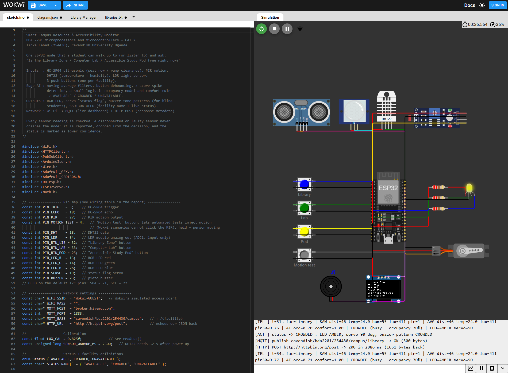
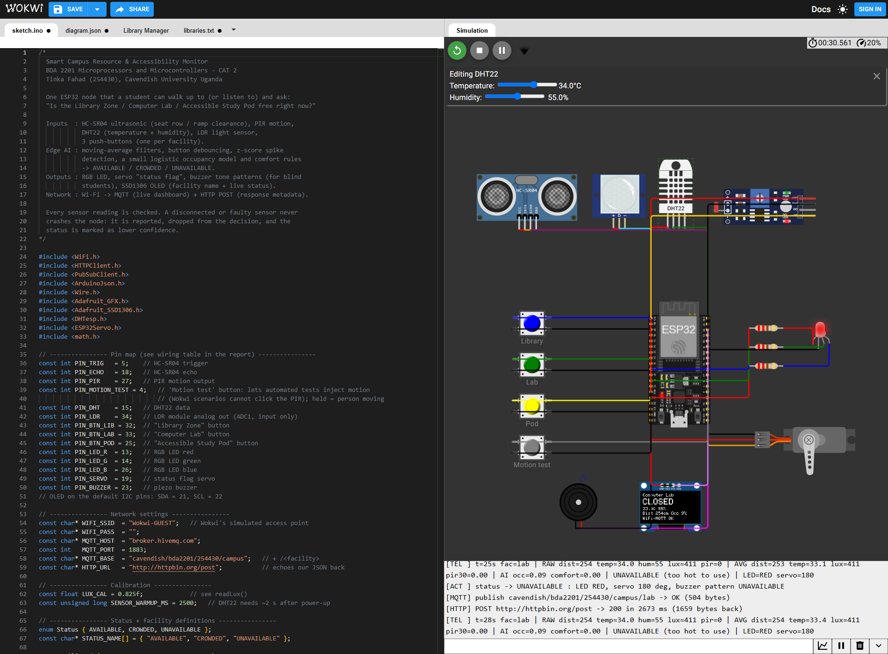
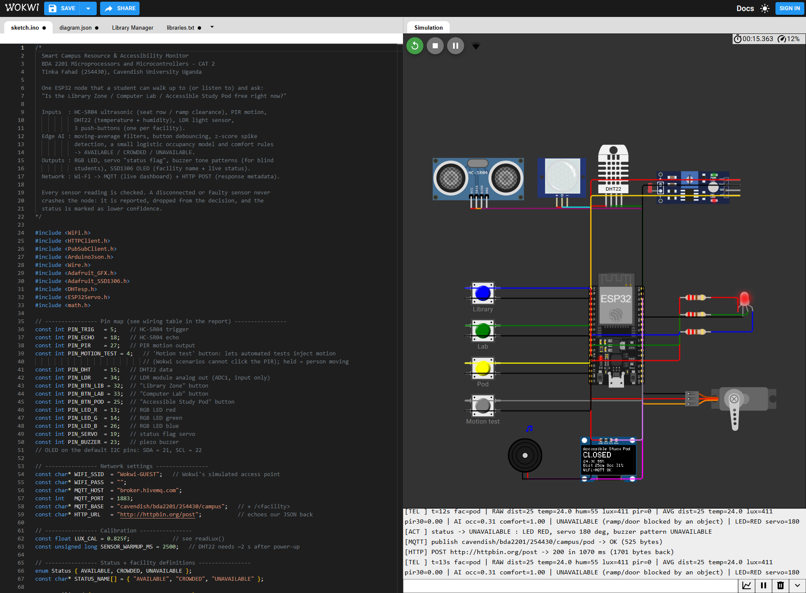

# Smart Campus Resource & Accessibility Monitor

**BDA 2201 Microprocessors and Microcontrollers – CAT 2**
Tinka Fahad · Reg. no. 254430 · Cavendish University Uganda

One ESP32 node that a student can walk up to (or listen to) and ask: *"Is the
Library Zone / Computer Lab / Accessible Study Pod free right now?"* The node
reads its sensors, decides on the board itself whether the space is
**AVAILABLE**, **CROWDED** or **UNAVAILABLE**, shows the answer with light,
movement, sound and text, and sends every reading to a live web dashboard over
Wi-Fi.

**Live dashboard:** https://tf254430-max.github.io/smart-campus-monitor/dashboard/
(it subscribes to the same MQTT topics the ESP32 publishes to; the last message
from each facility is kept on the broker, so the cards fill in even when the
simulation is not running).

---

## What is in this repository

| Path | What it is |
|---|---|
| `SmartCampusMonitor.ino` | The firmware (Arduino core for ESP32 3.0.7) |
| `diagram.json` | The Wokwi circuit (all parts and wires) |
| `diagram_fault_dht.json` | Same circuit with the DHT22 data wire removed (fault test) |
| `diagram_fault_two.json` | DHT22 **and** ultrasonic echo wire removed (two-fault test) |
| `libraries.txt` | Libraries Wokwi needs to build the sketch |
| `wokwi.toml` | Config for running the compiled firmware with the Wokwi VS Code extension / CLI |
| `scenarios/` | Automated Wokwi test scenarios (Library, Lab, Pod, fault, light calibration) |
| `dashboard/index.html` | MQTT live dashboard (works from GitHub Pages or by opening the file) |
| `evidence/` | Screenshots and serial logs from the test runs |

## Hardware

| Part | ESP32 pin | Job |
|---|---|---|
| HC-SR04 ultrasonic | TRIG 5, ECHO 18 | Distance to the seat row / pod ramp |
| PIR motion sensor | 27 | People moving in the space |
| DHT22 | 15 | Temperature and humidity |
| LDR light module | 34 (ADC1) | Room light in lux |
| Buttons: Library / Lab / Pod | 32 / 33 / 25 | Student picks the facility (internal pull-ups) |
| "Motion test" button | 4 | Lets the automated tests inject motion, because a Wokwi scenario cannot trigger the PIR |
| RGB LED (+3 × 220 Ω) | R 13, G 14, B 26 | Green / amber / red status |
| Servo | 19 | Status flag: 0° free, 90° busy, 180° closed |
| Piezo buzzer | 23 | 1 high beep = free, 2 medium = busy, 3 low = unavailable |
| SSD1306 OLED 128×64 | SDA 21, SCL 22 (0x3C) | Facility name, status and the readings behind it |

## How the decision is made (edge AI)

1. **Clean the readings.** Each sensor has its own moving-average window
   (distance 5, light 4, temperature/humidity 8). A reading that jumps more than
   3 standard deviations from the recent average is treated as a spike and
   ignored. If it is still there after 3 readings it is a real change, and the
   window restarts at the new level.
2. **Estimate occupancy.** A small logistic model combines how often the PIR
   fired in the last 30 s, how close the nearest person is and how warm the
   room is:
   `occupancy = 1 / (1 + e^-(−3.2 + 2.6·pir + 2.4·closeness + 0.9·heat))`
3. **Comfort index** (0–1) from temperature, humidity and light against the
   limits for that facility.
4. **Rules** turn these into a status:
   * UNAVAILABLE: pod ramp blocked, too hot, too dark, or two sensors offline
   * CROWDED: pod in use, occupancy ≥ 70 %, or poor comfort
   * AVAILABLE: otherwise

A sensor that stops answering is reported (`[WARN]` on serial, `sensor_faults`
in the JSON, a warning on the dashboard) and left out of the decision. The node
never freezes on a dead sensor.

## Telemetry

Sensors are read once a second and printed on the serial monitor as a `[TEL ]`
line. On every status change, and as a heartbeat every 10 s, the node:

* publishes JSON to `cavendish/bda2201/254430/campus/<library|lab|pod>` on
  `broker.hivemq.com:1883` (retained), and
* POSTs the same JSON to `http://httpbin.org/post` (on a change, otherwise
  every 30 s) and records the response code and round-trip time. These are
  shown on the dashboard.

## Running it

**In the browser:** create a new ESP32 project on wokwi.com, then paste in
`SmartCampusMonitor.ino` (as `sketch.ino`), `diagram.json` and `libraries.txt`.
Press ▶. Use the three coloured buttons to choose a facility, and click a sensor
to change its value (distance, temperature, light) or press *Simulate motion* on
the PIR. Open the dashboard link above in another tab to watch the messages
arrive.

**From the command line:** compile with arduino-cli, then run a scenario:

```
arduino-cli compile --fqbn esp32:esp32:esp32 --output-dir build .
wokwi-cli --scenario scenarios/test_A_library.yaml --timeout 300000 .
```

## Test results

All runs below were done in the Wokwi ESP32 simulator. The screenshots are in
`evidence/screenshots/` and the full serial output of each run is in
`evidence/serial-logs/`.

| Test | What I changed | Result |
|---|---|---|
| A – Library Zone | Start: quiet room, bright light, 24 °C | **AVAILABLE**, green LED, servo 0° |
| | Seat row at 45 cm + people moving | **CROWDED** – occupancy 70 %, amber, servo 90° |
| | Lights dropped to 8 lux | **UNAVAILABLE** – lights off / too dark, red, servo 180° |
| B – Computer Lab | 45 °C for under 3 readings (glitch) | Stays **AVAILABLE** – sudden spike ignored |
| | 31.5 °C held | Accepted after 3 readings → **CROWDED** (hot) |
| | 34 °C held | **UNAVAILABLE** – too hot to use |
| C – Study Pod | Object 25 cm from the ramp, no movement | **UNAVAILABLE** – ramp/door blocked |
| | Ramp cleared (250 cm) | **AVAILABLE** again |
| | Student inside (motion) | **CROWDED** – pod in use |
| Fault 1 | DHT22 data wire removed | Keeps running: **AVAILABLE** – one sensor offline, `[WARN]` every reading |
| Fault 2 | DHT22 and ultrasonic echo removed | Fails safe: **UNAVAILABLE** – sensors offline, OLED shows both faults |

| Library – busy | Lab – too hot | Pod – ramp blocked |
|---|---|---|
|  |  |  |
